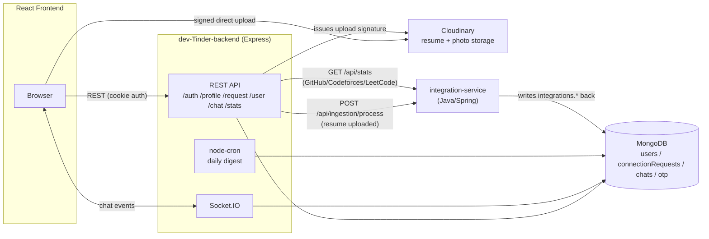
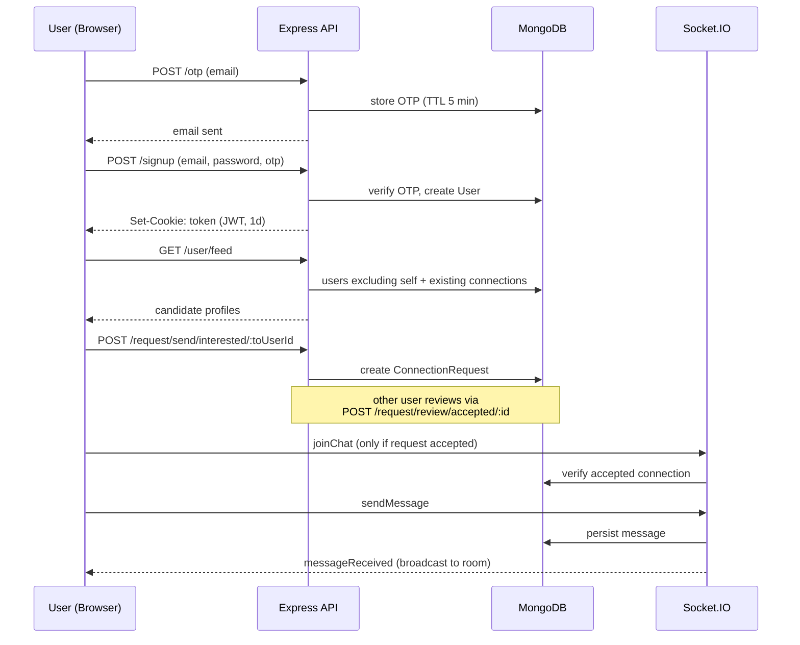
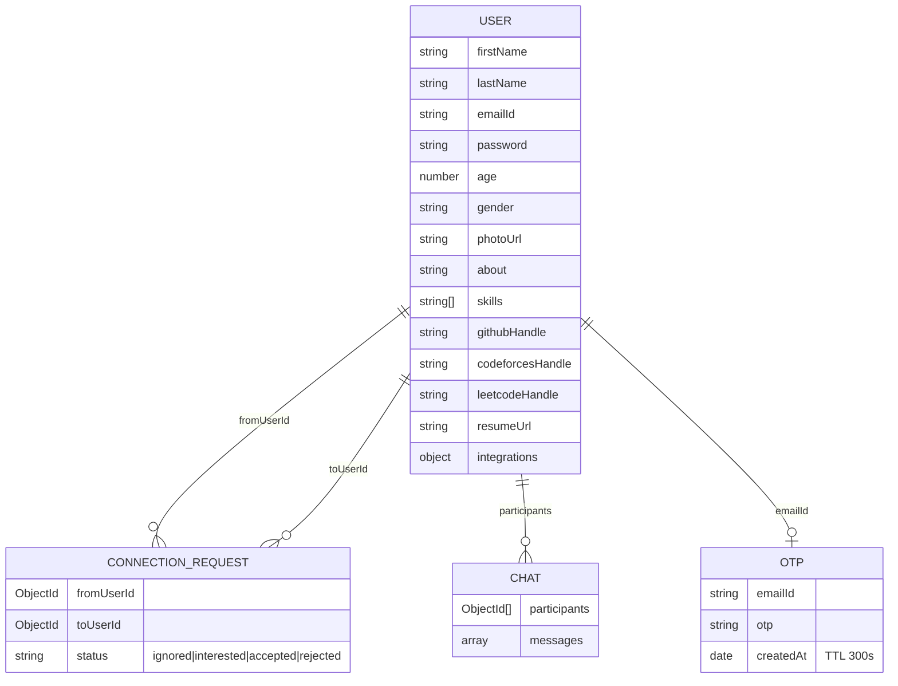

# DevTinder — Backend

Node.js/Express API for **DevTinder** ("Tinder for developers"): auth, profiles, swipe/connection requests, real-time chat, and a resume pipeline that hands off to the [integration-service](../integration-service) for AI-powered parsing and stats.

## Tech stack

| Concern | Choice |
|---|---|
| Runtime | Node.js + Express 5 |
| Database | MongoDB via Mongoose 8 |
| Auth | JWT (`jsonwebtoken`) in an httpOnly cookie + `bcrypt` password hashing |
| Real-time | Socket.IO |
| File storage | Cloudinary (browser uploads directly, via signed signatures issued by this API) |
| Email | Custom transactional mail API (`PROMAIL_API_KEY`) |
| Scheduling | `node-cron` (daily digest email) |

## Sessions and developer search

Login and signup issue JWTs with a **one-day (86,400-second) lifetime**, with matching one-day HttpOnly, Secure, SameSite=None cookies. HTTP authentication also enforces a one-day maximum token age, so an older seven-day token is rejected once it is over 24 hours old. Users with those older sessions will need to sign in again after deployment; no signing-key rotation is required.

Authenticated `GET /user/search?q=am&page=1` searches first and last names by a case-insensitive **prefix**. For example, `am` matches Aman, Amanda and Amit. Query text must contain 2–80 characters; regex punctuation is treated literally. Results exclude the caller and contain only public profile fields, with 20 profiles per page and a `hasMore` flag. Responses use `{ users, page, hasMore }`; page numbers range from 1 to 1000. This endpoint uses MongoDB only, without fetching platform stats or calling AI services.

## Architecture



Resume ingestion and cleanup use `STATS_SERVICE_URL`, with `http://localhost:8080` as the local fallback. Set the deployed Spring service's base URL in Render for production.

## Request flow: sign up → match → chat



## Data models



## API reference

| Method | Route | Auth | Description |
|---|---|---|---|
| POST | `/otp` | — | Generate + email a signup OTP |
| POST | `/signup` | — | Verify OTP, create account, set JWT cookie |
| POST | `/login` | — | Login, set JWT cookie |
| POST | `/logout` | ✅ | Clear JWT cookie |
| GET | `/profile/view` | ✅ | Own profile, enriched with live stats |
| GET | `/profile/view/:userId` | ✅ | Another user's public profile |
| PATCH | `/profile/edit` | ✅ | Edit whitelisted profile fields |
| PATCH | `/profile/password` | ✅ | Change password |
| GET | `/profile/resume/upload-signature` | ✅ | Signed payload for direct Cloudinary upload |
| GET | `/profile/resume/destroy-signature` | ✅ | Signed payload to delete old resume from Cloudinary |
| PATCH | `/profile/resume` | ✅ | Persist resume metadata; triggers ingestion in integration-service |
| GET | `/user/feed` | ✅ | Paginated candidate feed (max 50/page) |
| GET | `/user/search?q=am&page=1` | ✅ | Case-insensitive first/last-name prefix search; 20 public profiles/page, excludes self |
| GET | `/user/requests/received` | ✅ | Incoming connection requests |
| GET | `/user/connections` | ✅ | Accepted connections |
| POST | `/request/send/:status/:toUserId` | ✅ | `status`: `interested` \| `ignored` |
| POST | `/request/review/:status/:requestId` | ✅ | `status`: `accepted` \| `rejected` |
| GET | `/chat/:targetUserId` | ✅ | Fetch/create chat history with a user |
| GET | `/stats` | ✅ | Proxy to integration-service dev-stats aggregator |

Auth (✅) is enforced by `middleware/auth.js`, which reads the `token` cookie.

## Project layout

```
src/
├── app.js                # entrypoint: middleware, route mounting, DB + socket bootstrap
├── config/
│   └── database.js       # mongoose.connect
├── middleware/
│   └── auth.js           # userAuth — JWT cookie verification
├── models/                # user, connectionRequests, chat, otp
├── routes/                # auth, profile, request, user, chat, stats
└── utils/
    ├── cronjobs.js        # daily "pending request" digest email
    ├── fetchStats.js      # backfills GitHub/Codeforces/LeetCode stats via integration-service
    ├── resumeUpload.js    # Cloudinary SDK config
    ├── send-email.js      # transactional email sender
    ├── socket.js          # Socket.IO chat handlers
    ├── validation.js      # signup / profile-edit field validation
    └── templates/         # HTML email templates
```

## Run guide

### Prerequisites
- Node.js 18+
- A MongoDB connection string (Atlas or local)
- Cloudinary account (for resume/photo uploads)
- (Optional, for full functionality) [integration-service](../integration-service) running on port `8080`

### 1. Install

```bash
cd dev-Tinder-backend
npm install
```

### 2. Configure environment

Create a `.env` file in `dev-Tinder-backend/` with:

```env
PORT=7777
DB_CONNECTION_STRING=
JWT_KEY=
FRONTEND_API_URL=http://localhost:5173

CLOUDINARY_CLOUD_NAME=
CLOUDINARY_API_KEY=
CLOUDINARY_API_SECRET=

PROMAIL_API_KEY=
EMAIL_KEY=

RUN_EMAIL_CRON=false
STATS_SERVICE_URL=http://localhost:8080
```

### 3. Run

```bash
npm run dev     # nodemon, auto-restart on change
# or
npm start        # plain node
```

The API + Socket.IO server starts on `PORT` (e.g. `http://localhost:7777`).

### 4. Verify

Resume uploads save a new `resumeDocumentId` on the authenticated user's profile.
The previous Cloudinary file is removed only after a successful save. Replacing
or removing a resume also notifies the integration service to delete its old
Pinecone vectors and Mongo chunks. Set `STATS_SERVICE_URL` to the running
integration service URL; it also retries retired search data every 60 seconds.
Cleanup makes no AI calls. Indexing a new PDF still requires embeddings.

Run `npm test` for CORS, resume lifecycle, one-day sessions, authenticated developer search, Android authentication, secure sockets, push installation ownership, transactional notification events, and streaming gateway regression checks. These tests use local fixtures and mocks, without connecting to a production database, sending email, or contacting Firebase/Gemini.

## Android sessions and secure messaging

The web application continues using the existing HTTP-only, Secure, SameSite=None cookie. Android calls `POST /mobile/login` or `POST /mobile/signup` with the same credential/OTP fields as the browser endpoints. The response is `{ message, data, token, expiresAt }`; `data` excludes password hashes. The Android JWT has issuer `devtinder-api`, audience `devtinder-android`, and exactly the existing one-day lifetime. It is not a Firebase Auth token, and there is no refresh-token endpoint.

Protected routes accept `Authorization: Bearer <native JWT>` or the existing cookie. A supplied invalid bearer token never falls back to a cookie. Native storage must encrypt the token using Android Keystore; never put it into browser localStorage. Browser login/signup and profile responses no longer return password hashes.

Socket.IO authenticates the browser cookie or Android `auth.token` during the handshake. It derives the sender from that session, disconnects at JWT expiry, and checks an accepted connection before joining, history access, and sending. Client-supplied sender names/IDs are ignored. `joinChat` supports an optional `{ ok, error? }` acknowledgement. `sendMessage` acknowledges `{ ok: true, message }` only after persistence or `{ ok: false, error }` after failure. A lost acknowledgement is ambiguous: clients must reload history before offering another explicit send, never automatically retry.

The `messageReceived` event retains `firstName`, `text`, and `photoUrl`, and adds `_id`, `senderId`, `targetUserId`, and `createdAt`. Clients should merge/deduplicate history and events by `_id`. Persistence acknowledgement is not a recipient delivery/read receipt. The existing chat document remains the storage model; this change does not add multi-server Socket.IO coordination or rewrite historical records.

HTTP and Socket.IO allow the existing `FRONTEND_API_URL` origin(s), plus the bundled Android origin `https://localhost`. Multiple explicitly approved browser origins may be comma-separated. HTTPS production APIs are required; the Android origin is not the API address.

## Authenticated AI streaming gateway

Both clients send `POST /ai/chat/stream` with JSON `{ "query": "..." }` and their normal authenticated session. Queries must contain 1–16000 characters. Node replaces any client-supplied user ID with the authenticated account and streams Spring's SSE response without buffering, preserving `status`, `sources`, `message`, and `error` events. Client disconnect aborts the upstream HTTP request. The answer budget is 130 seconds; frontend readiness waiting happens separately before sending.

Configure a separate `AI_GATEWAY_SECRET` of at least 32 UTF-8 bytes on Node and Spring. Keep `STATS_SERVICE_URL` pointed at the existing integration service. No Gemini key or database credentials belong in the client.

Node sends three headers: `X-DevTinder-Timestamp` (epoch seconds), `X-DevTinder-User` (canonical account ID), and `X-DevTinder-Signature` (hex HMAC-SHA256). The signed UTF-8 text is `POST\n/api/chat/stream\n<userId>\n<timestamp>\n<sha256(query).hex>`, where `\n` denotes actual newlines. Spring verifies signature, freshness, and query binding. Upstream authentication/configuration failures become 503 rather than invalidating a valid client session.

Deployment must be coordinated: introduce the gateway, update the frontend, then require signed Spring requests. Spring's explicit `AI_GATEWAY_REQUIRED=false` compatibility window may temporarily support old web clients; the final setting must be `true`. Do not expose `AI_GATEWAY_SECRET` through Vite. The public Spring health ping stays separate. This does not secure every existing stats/ingestion endpoint.

## Firebase Android notifications

Notifications are **off by default**. Existing deployments require no Firebase credential and do not start a dispatcher until `PUSH_NOTIFICATIONS_ENABLED=true` is explicitly configured. No external Firebase resources or production configuration are created by this code.

Required server configuration when enabling notifications:

| Variable | Purpose |
|---|---|
| `PUSH_NOTIFICATIONS_ENABLED=true` | Enables transactional notification creation and dispatch |
| `PUSH_ENVIRONMENT=production` | Selects matching installation records; use `development` for isolated fixtures |
| `GOOGLE_APPLICATION_CREDENTIALS` | Absolute path to a privately mounted Firebase service-account JSON file |

Use separate Firebase development/production projects and credentials with permission to send FCM messages. Keep service-account files outside Git and outside the frontend. Firebase Cloud Messaging uses the Admin SDK only; Firebase Authentication, Firestore, Cloud Functions, and a new hosting worker are not required.

To verify a development credential without starting the server or touching MongoDB, set `GOOGLE_APPLICATION_CREDENTIALS` in the current terminal to the private JSON path, then run `npm.cmd run firebase:check -- --project=devtinder-development` from this repository. The command checks that the key belongs to the expected project and submits an FCM validation-only request. It never sends a device notification, enables the dispatcher, changes environment files, or prints credential values. A successful validation does not prove device delivery. Use your actual project ID if it differs. Firebase CLI login and Android `google-services.json` do not replace this backend credential.

The backend `.npmrc` omits optional dependencies because Firebase Admin's optional Firestore/Cloud Storage clients are unused. Standard `npm install`/`npm ci` in this repository respects that setting; do not copy this configuration to the Vite frontend. If a future feature uses those Firebase clients or optional MongoDB authentication/compression modules, explicitly review and install the needed optional packages. The current FCM app/messaging imports and existing username/password MongoDB flow do not require them.

Dependency review: the existing baseline has 18 npm audit findings (3 moderate, 14 high, 1 critical). The scoped optional omission avoids introducing the six additional moderate findings from the unused Firestore tree; it does not repair the unrelated baseline findings. No force upgrades or transitive major-version overrides were applied. Review the baseline advisories before a production release.

### Device API

* `PUT /push/installations/:installationId`: JWT-authenticated registration/renewal. Body: `{ token, installationSecret, platform: "android", environment: "development" | "production" }`. Returns `{ bindingId, expiresAt }`.
* `PUT /push/installations/:installationId/token`: body `{ token }`; requires `X-Installation-Secret`, independent of JWT lifetime. Rotates only the existing installation's token, not its owner or subscription expiry.
* `DELETE /push/installations/:installationId`: requires `X-Installation-Secret`; disables that installation only and returns 204.

Installation IDs contain 16–128 ASCII letters/digits/underscores/hyphens. Secrets contain 32–256 of those characters and must be generated with secure randomness; store them with the native encrypted installation state. Tokens have a bounded size and are never returned. Include `X-Installation-Binding` on rotation and revocation whenever known: a stale binding returns 409 and cannot disable a newly signed-in account. Network clients should retain failed revocation details for a later retry, while disabling local notification display immediately.

The secret is hashed on the server. Registering an existing ID requires its secret; initial registration uses insert-only semantics so concurrent claims cannot overwrite ownership. Account changes create a new binding; authenticated renewals for the same active account preserve it. Tokens/installation IDs have unique indexes. Multiple phones per user are supported. Subscriptions expire 30 days after the last authenticated renewal, independently of the one-day JWT. Generic alerts can continue after JWT expiry, but opening protected content requires signing in again.

### Persistence, delivery and limitations

`PushInstallation` and `NotificationEvent` are separate collections, never part of public profile DTOs. When push is enabled, a message or interested connection request and its notification event commit in one MongoDB transaction. MongoDB must be a replica set/Atlas deployment; a standalone development MongoDB is insufficient. Collections/indexes initialize before the enabled server listens. Failed saves produce neither a broadcast nor a push event. Ignored/reviewed requests and old messages do not create alerts.

The dispatcher runs inside the existing Node process, leases events, sends high-priority **data-only** FCM messages, records successful binding deliveries, removes definitively invalid tokens, and retries transient failures up to six attempts with bounded backoff. Expired processing leases recover after restart; final-attempt crashes become failed events rather than permanent leases. Per-send deadlines and lease renewal bound stalled work. Events expire after 24 hours. There is no exactly-once delivery guarantee: a crash after FCM acceptance can resend the same event, so Android must deduplicate `eventId` before showing it.

Payload: `{ eventId, type: "message" | "connection_request", bindingId, targetUserId?, createdAt, expiresAt }`. Message events identify the sender as `targetUserId` for the recipient's chat route. No message content, sender name, JWT, or resume content goes to FCM. A native FirebaseMessagingService checks the locally enabled account binding, expiry, and duplicate ID before rendering a generic notification, including when React is not running. On logout/account change it must immediately disable the old binding and clear old notifications; merely deleting the backend token cannot recall an already queued push.

Render sleeping, offline devices, force-stop, battery restrictions, and absent Google Play services can delay or prevent alerts. Pending events survive Node restarts, but dispatch resumes only when the existing service is running. No keepalive or additional always-on worker is introduced.

### Release checks and rollback

Before enabling production push, run isolated replica-set transaction tests and two-user web/Android messaging, token rotation, offline logout, account switching, expired login, foreground/background/killed-process, and notification-tap tests using a development Firebase project. Never point these tests at production MongoDB or send real user alerts.

Disable `PUSH_NOTIFICATIONS_ENABLED` to stop new notification events/dispatch without changing normal messaging. Retain additive collections for investigation; do not delete production data during rollback. Pending events may resume if enabled before expiry. Do not reopen unsigned AI endpoints to recover a failed gateway deployment; disable the AI feature temporarily instead. No production deployment or credentials were changed by this implementation.

```bash
curl http://localhost:7777/profile/view      # current middleware returns 400 "Invalid Token" without a session cookie
```
