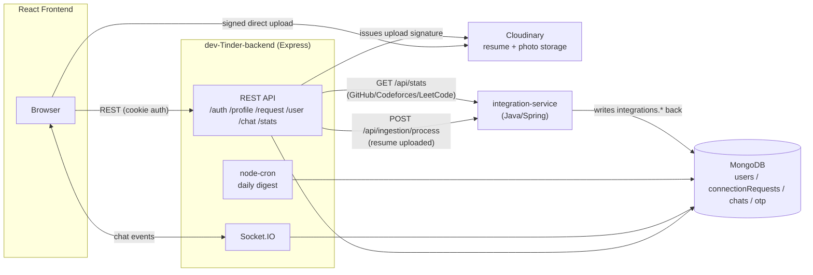
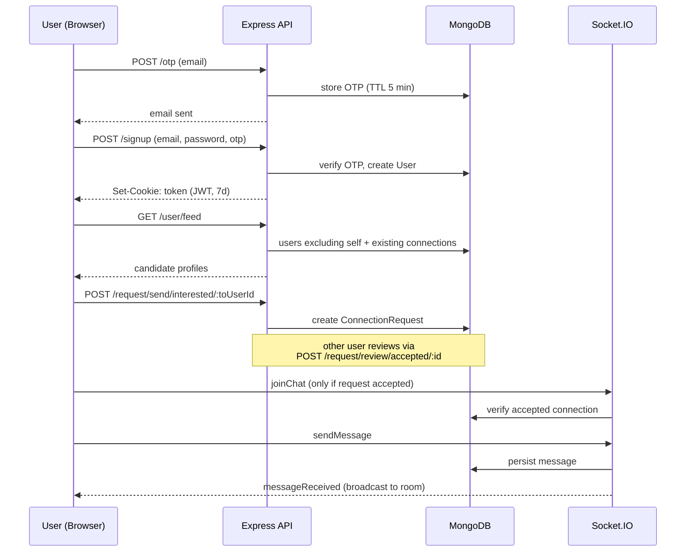
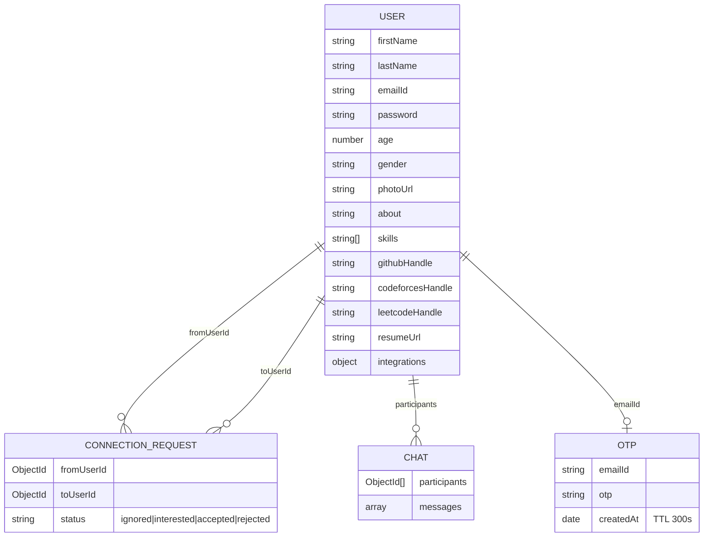

# DevTinder — Backend

Node.js/Express API for **DevTinder** ("Tinder for developers"): auth, profiles, swipe/connection requests, real-time chat, and a resume pipeline that hands off to the [integration-service](../integration-service) for AI-powered parsing and stats.

## Tech stack

| Concern | Choice |
|---|---|
| Runtime | Node.js + Express 5 |
| Database | MongoDB via Mongoose 8 |
| Auth | JWT (`jsonwebtoken`) in an httpOnly cookie + `bcrypt` password hashing |
| Real-time | Socket.IO |
| File storage | Cloudinary (browser uploads directly, via signed signatures issued by this API) |
| Email | Custom transactional mail API (`PROMAIL_API_KEY`) |
| Scheduling | `node-cron` (daily digest email) |

## Architecture



> ⚠️ The call to `integration-service` from `routes/profile.js` (resume ingestion webhook) is currently **hardcoded to `http://localhost:8080`** rather than reading an env var. It works when both services run locally together, but will need updating for a real multi-host deployment.

## Request flow: sign up → match → chat



## Data models



## API reference

| Method | Route | Auth | Description |
|---|---|---|---|
| POST | `/otp` | — | Generate + email a signup OTP |
| POST | `/signup` | — | Verify OTP, create account, set JWT cookie |
| POST | `/login` | — | Login, set JWT cookie |
| POST | `/logout` | ✅ | Clear JWT cookie |
| GET | `/profile/view` | ✅ | Own profile, enriched with live stats |
| GET | `/profile/view/:userId` | ✅ | Another user's public profile |
| PATCH | `/profile/edit` | ✅ | Edit whitelisted profile fields |
| PATCH | `/profile/password` | ✅ | Change password |
| GET | `/profile/resume/upload-signature` | ✅ | Signed payload for direct Cloudinary upload |
| GET | `/profile/resume/destroy-signature` | ✅ | Signed payload to delete old resume from Cloudinary |
| PATCH | `/profile/resume` | ✅ | Persist resume metadata; triggers ingestion in integration-service |
| GET | `/user/feed` | ✅ | Paginated candidate feed (max 50/page) |
| GET | `/user/requests/received` | ✅ | Incoming connection requests |
| GET | `/user/connections` | ✅ | Accepted connections |
| POST | `/request/send/:status/:toUserId` | ✅ | `status`: `interested` \| `ignored` |
| POST | `/request/review/:status/:requestId` | ✅ | `status`: `accepted` \| `rejected` |
| GET | `/chat/:targetUserId` | ✅ | Fetch/create chat history with a user |
| GET | `/stats` | ✅ | Proxy to integration-service dev-stats aggregator |

Auth (✅) is enforced by `middleware/auth.js`, which reads the `token` cookie.

## Project layout

```
src/
├── app.js                # entrypoint: middleware, route mounting, DB + socket bootstrap
├── config/
│   └── database.js       # mongoose.connect
├── middleware/
│   └── auth.js           # userAuth — JWT cookie verification
├── models/                # user, connectionRequests, chat, otp
├── routes/                # auth, profile, request, user, chat, stats
└── utils/
    ├── cronjobs.js        # daily "pending request" digest email
    ├── fetchStats.js      # backfills GitHub/Codeforces/LeetCode stats via integration-service
    ├── resumeUpload.js    # Cloudinary SDK config
    ├── send-email.js      # transactional email sender
    ├── socket.js          # Socket.IO chat handlers
    ├── validation.js      # signup / profile-edit field validation
    └── templates/         # HTML email templates
```

## Run guide

### Prerequisites
- Node.js 18+
- A MongoDB connection string (Atlas or local)
- Cloudinary account (for resume/photo uploads)
- (Optional, for full functionality) [integration-service](../integration-service) running on port `8080`

### 1. Install

```bash
cd dev-Tinder-backend
npm install
```

### 2. Configure environment

Create a `.env` file in `dev-Tinder-backend/` with:

```env
PORT=7777
DB_CONNECTION_STRING=
JWT_KEY=
FRONTEND_API_URL=http://localhost:5173

CLOUDINARY_CLOUD_NAME=
CLOUDINARY_API_KEY=
CLOUDINARY_API_SECRET=

PROMAIL_API_KEY=
EMAIL_KEY=

RUN_EMAIL_CRON=false
STATS_SERVICE_URL=http://localhost:8080
```

### 3. Run

```bash
npm run dev     # nodemon, auto-restart on change
# or
npm start        # plain node
```

The API + Socket.IO server starts on `PORT` (e.g. `http://localhost:7777`).

### 4. Verify

```bash
curl http://localhost:7777/profile/view      # expect 401 without a session cookie — confirms the server is up
```
